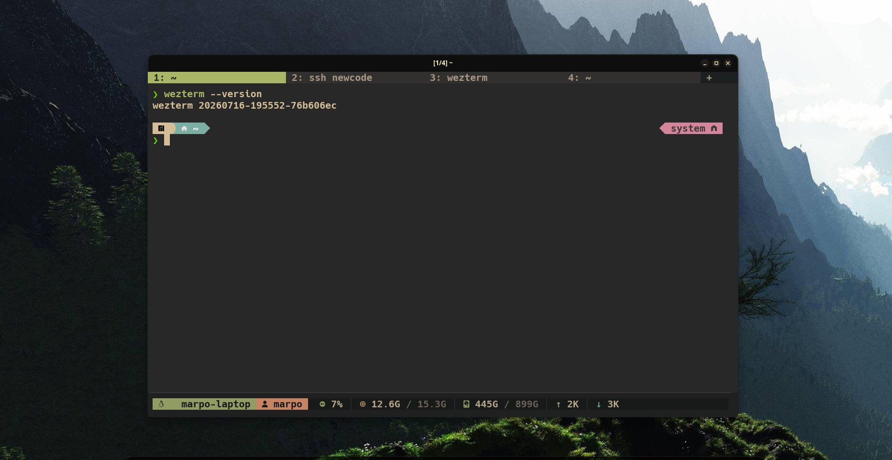

# marpo-wezterm

My [WezTerm](https://wezfurlong.org/wezterm/) configuration.



## Install

```bash
git clone https://github.com/marcosportes/marpo-wezterm.git
cd marpo-wezterm
./setup.sh
```

## Update

```bash
./setup.sh
```

`setup.sh` pulls the latest changes, installs WezTerm if missing, and syncs the config to `~/.config/wezterm`, backing up the old config if it differs.

Supported: Arch/Manjaro, Debian/Ubuntu/Mint, Fedora, openSUSE. Other distros fall back to Flatpak.

Use `./setup.sh --no-pull` to skip the `git pull`.

## Layout

- `wezterm.lua`: entry point
- `lua/core/`: base settings (options, appearance, fonts, keymaps, mouse)
- `lua/plugins/`: features (SSH picker, colored tabs, session restore, themes, help, update)
- `lua/custom/`: personal tweaks (`preferences.lua`)
- `scripts/`: helper shell scripts
- `fonts/`: bundled Hack Nerd Font Mono, loaded via `font_dirs` (no system install needed)

Shortcuts: see [SHORTCUTS.md](SHORTCUTS.md).

## Wayland and window buttons

WezTerm runs through XWayland by default. For native Wayland, set
`PREFER_WAYLAND = true` at the top of `lua/core/options.lua`.

The window always uses the desktop's own title bar (minimize/maximize/close), so the
buttons never show up twice. GNOME and Pantheon draw no title bars for native Wayland
apps, so on those desktops WezTerm stays on XWayland even with `PREFER_WAYLAND = true`.
KDE, Cinnamon, Sway, etc. use native Wayland.

To add another desktop without Wayland title bars, list it in `NO_SSD_DESKTOPS` in
`lua/core/options.lua`.

## GPU acceleration (optional)

The default renderer is `OpenGL`, which is already GPU accelerated. To use the newer
`WebGpu` renderer (Vulkan on Linux) and choose which GPU it runs on, edit
`lua/core/options.lua`:

```lua
config.front_end = 'WebGpu'                         -- default: 'OpenGL'
config.webgpu_power_preference = 'HighPerformance'  -- dedicated GPU (e.g. NVIDIA)
-- config.webgpu_power_preference = 'LowPower'      -- integrated GPU, saves battery
```

Restart WezTerm after changing it. To list the available GPUs, open the debug overlay
(`Ctrl+Shift+L`) and run `wezterm.gui.enumerate_gpus()`. Use `nvidia-smi` to confirm `wezterm-gui` is running on the NVIDIA card. If you see rendering
glitches, switch back to `'OpenGL'`.

Note: `./setup.sh` syncs the repo over `~/.config/wezterm`, so it will revert this change.
